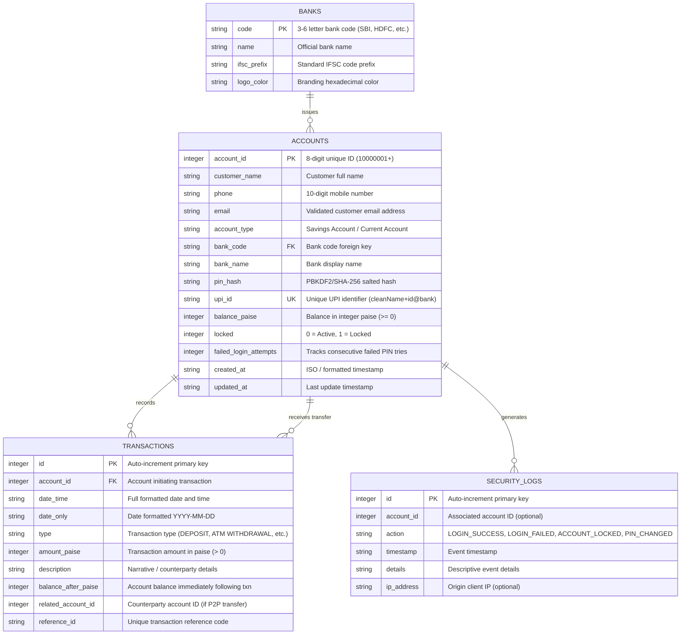

# Database Schema & Data Architecture
## Bank Account Management System Using C++

### 1. Entity-Relationship (ER) Diagram



---

### 2. Monetary Precision: Integer Paise Model

> [!IMPORTANT]
> **Why Integer Paise?**  
> In real financial software and standard banking practice, monetary balances must never be stored as floating-point numbers (`FLOAT` or `DOUBLE`) because binary floating-point representation introduces rounding anomalies (such as `0.1 + 0.2 = 0.30000000000000004`).  
> In this system:
> - **1 Rupee = 100 Paise**
> - A deposit of ₹500.00 is stored in SQLite as `50000` paise.
> - All calculations, additions, and subtractions are executed with pure 64-bit integer arithmetic.
> - Balances are constrained with `CHECK(balance_paise >= 0)` to mathematically prevent negative account balances.

---

### 3. Detailed Table Definitions (DDL)

#### 3.1 `banks`
```sql
CREATE TABLE banks (
  code TEXT PRIMARY KEY,
  name TEXT NOT NULL,
  ifsc_prefix TEXT NOT NULL,
  logo_color TEXT NOT NULL
);
```

#### 3.2 `accounts`
```sql
CREATE TABLE accounts (
  account_id INTEGER PRIMARY KEY,
  customer_name TEXT NOT NULL,
  phone TEXT NOT NULL,
  email TEXT NOT NULL,
  account_type TEXT NOT NULL,
  bank_code TEXT NOT NULL,
  bank_name TEXT NOT NULL,
  pin_hash TEXT NOT NULL,
  upi_id TEXT NOT NULL UNIQUE,
  balance_paise INTEGER NOT NULL DEFAULT 0 CHECK(balance_paise >= 0),
  locked INTEGER NOT NULL DEFAULT 0,
  failed_login_attempts INTEGER NOT NULL DEFAULT 0,
  created_at TEXT NOT NULL,
  updated_at TEXT NOT NULL,
  FOREIGN KEY (bank_code) REFERENCES banks(code)
);
```

#### 3.3 `transactions`
```sql
CREATE TABLE transactions (
  id INTEGER PRIMARY KEY AUTOINCREMENT,
  account_id INTEGER NOT NULL,
  date_time TEXT NOT NULL,
  date_only TEXT NOT NULL,
  type TEXT NOT NULL,
  amount_paise INTEGER NOT NULL,
  description TEXT NOT NULL,
  balance_after_paise INTEGER NOT NULL,
  related_account_id INTEGER,
  reference_id TEXT NOT NULL,
  FOREIGN KEY (account_id) REFERENCES accounts(account_id)
);
```

#### 3.4 `security_logs`
```sql
CREATE TABLE security_logs (
  id INTEGER PRIMARY KEY AUTOINCREMENT,
  account_id INTEGER,
  action TEXT NOT NULL,
  timestamp TEXT NOT NULL,
  details TEXT NOT NULL,
  ip_address TEXT
);
```

---

### 4. Database Indexing Design
To ensure rapid query responses on account lookups, daily limit calculations, and transaction histories, the following indexes are maintained:
```sql
CREATE INDEX idx_transactions_account ON transactions(account_id);
CREATE INDEX idx_transactions_date ON transactions(date_only);
CREATE INDEX idx_accounts_phone ON accounts(phone);
CREATE INDEX idx_accounts_upi ON accounts(upi_id);
```
