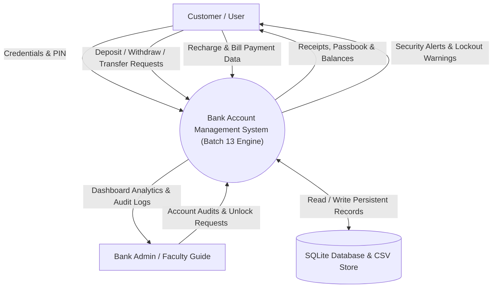
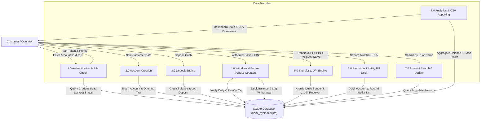
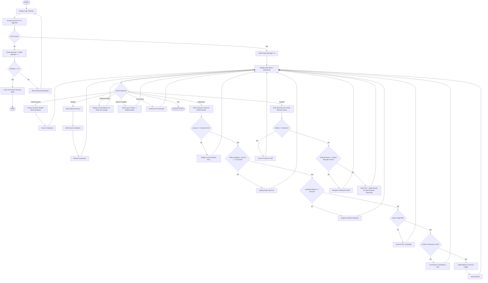

# Workflow & Data Flow Diagrams (DFD)
## Bank Account Management System Using C++

### 1. Data Flow Diagram (DFD) — Level 0 (Context Diagram)

---

### 2. Data Flow Diagram (DFD) — Level 1 (Modular Functional Decomposition)

---

### 3. Master Banking Transaction Flowchart

The algorithm below corresponds to the exact flowchart in Chapter 1.4 of the college project report:

